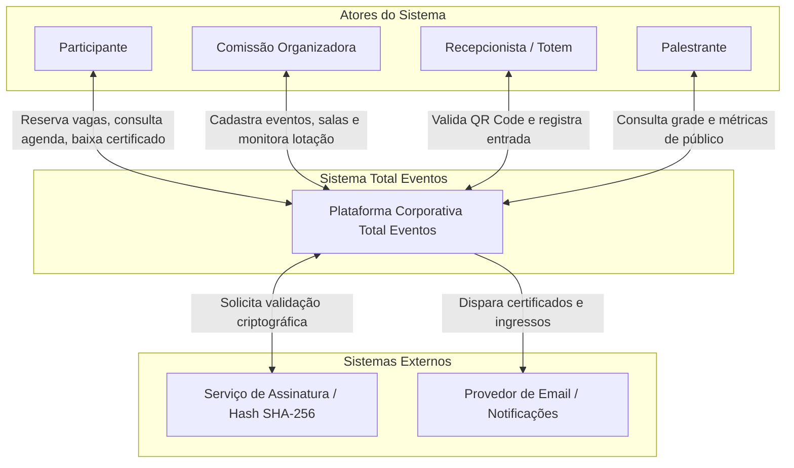

# Modelagem Conceitual do Domínio — Total Eventos

**Trabalho:** Da Informação ao Domínio: Construindo o Modelo Conceitual do Sistema

**Sistema Analisado:** Total Eventos

**Alunos:** Fernando Villar, Emmanuelly Madeira

**Data:** 21 de Setembro de 2026

---

## 1. Apresentação e Síntese do Sistema

* **Nome do Sistema:** **Total Eventos**

* **Problema Central:** Em eventos de médio e grande porte, a gestão descentralizada e manual provoca filas extensas no credenciamento presencial, sobrecarga física em auditórios com risco de sobrepopulação, choques de horário na agenda dos participantes e falhas na consolidação da frequência para a emissão de certificados oficiais.

---

## 2. Diagrama de Ecossistema

O Diagrama de Ecossistema contextualiza o sistema **Total Eventos** com seus atores humanos e sistemas externos parceiros:

---

## 3. Conceitos Candidatos Mapeados

Abaixo estão os conceitos identificados e classificados no domínio do sistema:

| # | Candidato a Conceito | Origem | Classificação | Justificativa do Domínio |
| --- | --- | --- | --- | --- |
| **1** | **Participante** | Fluxo / Informação | **C** (Entidade) | Ator principal que consulta a grade, realiza a reserva e apresenta o ingresso na entrada.

 |
| **2** | **Reserva / Ingresso** | Operação | **C** (Entidade) | Insumo gerado ao confirmar a inscrição; indispensável para validar o direito de acesso.

 |
| **3** | **QR Code Assinado (Token)** | Informação / Operação | **C** (Objeto de Valor) | Credencial criptográfica gerada com carimbo temporal para validação local rápida nos leitores.

 |
| **4** | **Sessão / Palestra** | Informação necessária | **C** (Entidade) | Representa o evento/atividade da programação com horário de início, término e local definidos.

 |
| **5** | **Espaço Físico / Sala** | Informação necessária | **C** (Entidade) | Local presencial que dita a capacidade física total e a invariante de segurança contra incêndios.

 |
| **6** | **Totem / Leitor** | Fluxo / Operação | **C** (Entidade) | Dispositivo autônomo na portaria que executa a validação do token e o controle local de entrada.

 |
| **7** | **Registro de Presença (Check-in)** | Operação | **C** (Entidade) | Evento registrado no ato do acesso com marcação de horário, utilizado no cálculo final de frequência.

 |
| **8** | **Certificado** | Operação / Fluxo | **C** (Entidade) | Documento emitido com hash criptográfico ao final do evento para participantes com frequência mínima.

 |
| **9** | **Margem de Segurança Offline** | Informação / Operação | **H** (Parâmetro) | Teto percentual configurado nos leitores offline para prevenir overbooking em sincronizações concorrentes.

 |
| **10** | **Cota VIP / Especial** | Informação necessária | **H** (Objeto de Valor) | Reserva de um percentual de vagas reservado para organizadores, convidados e palestrantes.

 |

---

## 4. Atributos Detalhados das Entidades Principais

### 1. Entidade: Espaço Físico / Sala

Define o local físico e seus limites regulatórios de segurança.

* **id:** Identificador único (UUID) do espaço.

* **nome:** Nome ou código do auditório/sala (ex: *Auditório Principal*, *Sala 02*).

* **capacidadeMaxima:** Limite máximo absoluto de pessoas permitido pelo alvará de segurança física contra incêndios (invariante RN02).

* **margemSegurancaOffline *(Objeto de Valor/Parâmetro)*:** Cota quantitativa ou percentual reservada para contenção de acessos em totens operando sem conexão de rede.

### 2. Entidade: SessaoPalestra *(Agregado Raiz de Lotação)*

Elemento central da programação que gerencia a alocação de espaço e o controle de público.

* **id:** Identificador único (UUID) da sessão.

* **titulo:** Nome da palestra ou atividade.

* **dataInicio:** Data e horário de início da sessão.

* **dataFim:** Data e horário de término.

* **espacoFisicoId:** Referência à sala física alocada (relação N:1).

* **ocupacaoAtual:** Contador em tempo real do número de check-ins presenciais realizados.

* **status:** Estado atual da sessão (Rascunho, Publicada, Encerrada).

### 3. Entidade: Reserva / Ingresso

Garante o direito de vaga do participante em uma sessão ou evento.

* **id:** Identificador único da reserva.

* **participanteId:** Referência ao participante titular da vaga.

* **sessaoId:** Referência à sessão ou evento reservado.

* **status:** Ciclo de vida da reserva (*Confirmada*, *Utilizada*, *Cancelada*).

* **dataCriacao:** Timestamp de efetivação da inscrição.

### 4. Entidade: Registro de Presença (Check-in)

Representa a entrada física validada no recinto.

* **id:** Identificador único do registro.

* **sessaoId:** Sessão onde ocorreu o acesso.

* **participanteId / ingressoId:** Vínculo com a credencial validada.

* **timestamp:** Carimbo temporal exato da entrada.

* **totemId:** Identificação do dispositivo de hardware que efetuou a leitura.

* **modoOperacao:** Indicador se o check-in ocorreu de forma *Online* ou *Offline* (com posterior sincronização).

### 5. Objeto de Valor: QR Code Assinado (Token)

Credencial criptográfica antifraude.

* **hashCriptografico:** Assinatura digital única gerada por chave de segurança.

* **tokenPayload:** Dados encapsulados (ID do participante, ID da sessão e validade temporal).

---

## 5. Explicação e Justificativa do Modelo

* **Identidades vs. Objetos de Valor:** Possuem identidade própria (*Participante, ReservaIngresso, SessaoPalestra, EspacoFisicoSala, TotemLeitor, RegistroPresenca e Certificado*), pois exigem ciclo de vida e auditoria única. Já o *QRCodeAssinado* foi tratado como Objeto de Valor por ser definido unicamente por seus atributos imutáveis.

* **Relações Críticas:** A cadeia `Participante` $\rightarrow$ `Reserva` $\rightarrow$ `Sessão` $\rightarrow$ `Sala` sustenta todo o controle de lotação, enquanto a cadeia `Totem` $\rightarrow$ `RegistroPresenca` $\rightarrow$ `Certificado` assegura a idoneidade da emissão documental.