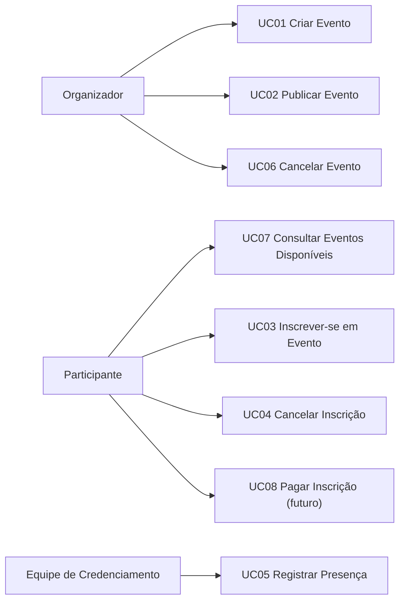
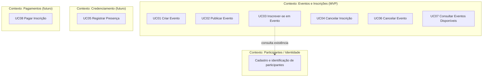
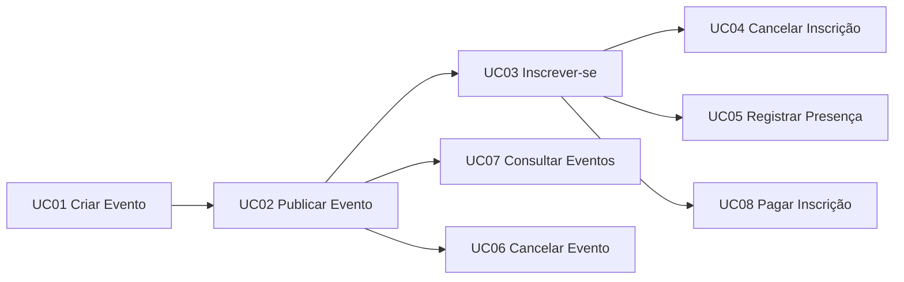
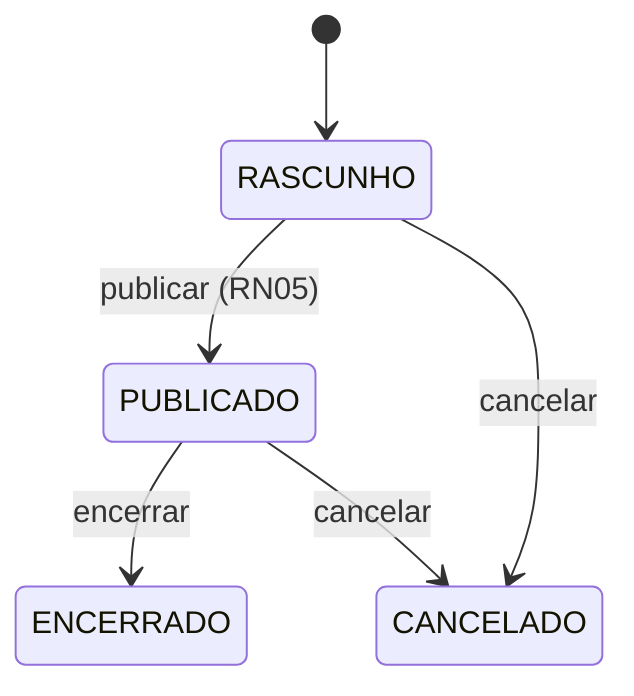
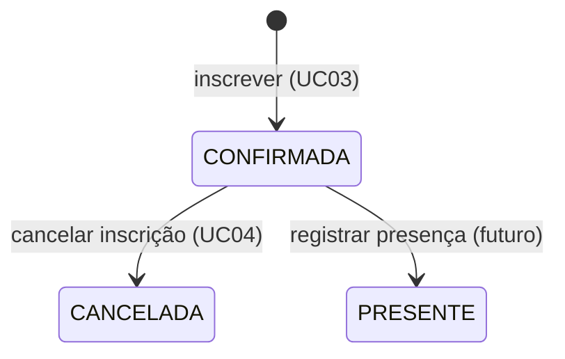
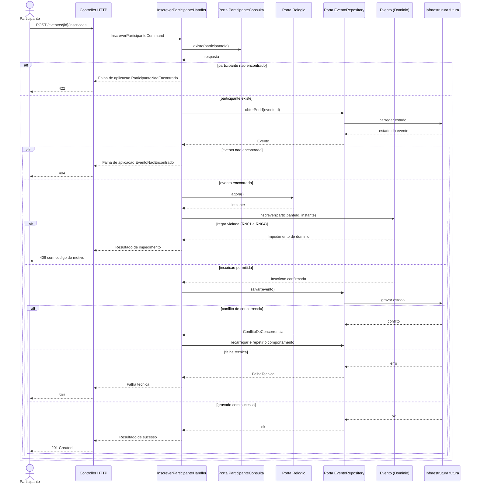
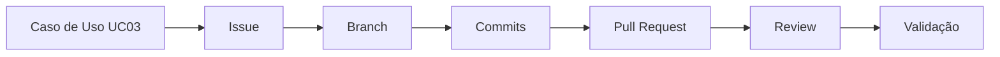

# Blueprint de Implementação do Primeiro Slice — Sistema de Organização de Eventos

| | |
|---|---|
| **Equipe** | Fernando, Emanuelly e Luiz Henrique |
| **Disciplina** | Desenvolvimento de Sistemas Corporativos |
| **Data** | 19/10/2026 |


---

## 01. Retomada do sistema

**Nome do sistema:** Sistema de Organização de Eventos (SOE).

**Problema central.** Organizadores de eventos (palestras, workshops, encontros acadêmicos e comunitários) controlam datas, locais, vagas e inscrições em planilhas e conversas de mensagens. Isso gera superlotação, inscrições duplicadas, falta de visibilidade sobre quem vai comparecer e dificuldade para saber o estado real de cada evento.

**Atores principais.** Organizador, Participante e Equipe de Credenciamento. Como atores secundários futuros: Gateway de Pagamento e Serviço de Notificação.

**Objetivo principal da solução.** Permitir que organizadores criem e publiquem eventos com capacidade controlada, e que participantes se inscrevam com garantia de que a capacidade e as regras do evento serão respeitadas.

**Principais conceitos do domínio já identificados.**

- **Evento**: ocorrência com título, local, período, capacidade, período de inscrições e estado.
- **Inscrição**: vínculo de um Participante com um Evento, com estado próprio.
- **Participante** e **Organizador**: pessoas com papéis distintos em relação ao evento.
- **Capacidade** e **Vaga**: limite de inscrições ativas e unidade ainda não ocupada.
- **Período de inscrições**: janela em que o evento aceita inscrições.
- **Conceitos futuros**: Ingresso, Lista de espera, Check-in, Pagamento.

**Principais Regras de Negócio já conhecidas.**

| ID | Regra |
|---|---|
| RN01 | Somente eventos **publicados** aceitam inscrições. |
| RN02 | Inscrições só são aceitas dentro do **período de inscrições** do evento. |
| RN03 | O número de inscrições ativas **nunca excede a capacidade** do evento. |
| RN04 | Um participante possui **no máximo uma inscrição ativa** por evento. |
| RN05 | Um evento só pode ser publicado se tiver título, local, período, capacidade maior que zero e período de inscrições coerente com o período do evento. |
| RN06 | Cancelar uma inscrição ativa **libera a vaga** imediatamente. |
| RN07 | Cancelar um evento cancela todas as suas inscrições ativas. *(futuro)* |
| RN08 | Somente o Organizador do evento pode publicá-lo, alterá-lo ou cancelá-lo. |

**Principais decisões arquiteturais já assumidas.**

- Separação entre fronteira (Controller), aplicação (Application Service / Handler), domínio e infraestrutura.
- O domínio decide e protege regras; a aplicação apenas coordena.
- Repositórios são **portas** que expressam necessidades do núcleo, não acesso a banco.
- HTTP é apenas uma forma de acionar comportamentos.
- ORM, PostgreSQL e Docker são tecnologias futuras de suporte.
- Monólito modular; microsserviços não são antecipados.


---

## 02. Atores e objetivos

| Ator | Objetivo | Resultado observável |
|---|---|---|
| Organizador | Disponibilizar um evento para o público com capacidade controlada | Evento publicado e visível para inscrição |
| Organizador | Acompanhar e encerrar a ocupação do evento | Evento cancelado, ou lista de inscritos consistente com a capacidade |
| Participante | Garantir um lugar em um evento de interesse | Inscrição confirmada, com vaga reservada em seu nome |
| Participante | Desistir de um evento sem manter a vaga ocupada | Inscrição cancelada e vaga liberada |
| Participante | Encontrar eventos aos quais pode se inscrever | Lista de eventos com inscrições abertas |
| Equipe de Credenciamento | Confirmar quem compareceu | Presença registrada para um inscrito |
| Gateway de Pagamento *(secundário, futuro)* | Efetivar a cobrança de inscrições pagas | Pagamento aprovado ou recusado |
| Serviço de Notificação *(secundário, futuro)* | Comunicar mudanças relevantes | Mensagem entregue ao participante |

Não foram tratados como atores: banco de dados, ORM, cache, logger, bibliotecas e módulos internos.

---

## 03. Identificação e revisão dos Casos de Uso

| ID | Caso de Uso | Ator principal | Objetivo | Resultado observável | Situação |
|---|---|---|---|---|---|
| UC01 | Criar Evento | Organizador | Registrar um novo evento em preparação | Evento existe em estado de rascunho | Mantido |
| UC02 | Publicar Evento | Organizador | Abrir o evento ao público | Evento publicado, visível e aberto a inscrições no período definido | Revisado |
| UC03 | Inscrever-se em Evento | Participante | Garantir lugar em um evento | Inscrição confirmada | Revisado |
| UC04 | Cancelar Inscrição | Participante | Desistir de um evento | Inscrição cancelada e vaga liberada | Mantido |
| UC05 | Registrar Presença | Equipe de Credenciamento | Confirmar comparecimento | Presença registrada para o inscrito | Novo |
| UC06 | Cancelar Evento | Organizador | Desfazer um evento que não ocorrerá | Evento cancelado e inscritos afetados | Novo |
| UC07 | Consultar Eventos Disponíveis | Participante | Encontrar eventos com vagas | Lista de eventos com inscrições abertas | Novo |
| UC08 | Pagar Inscrição | Participante | Efetivar a participação em evento pago | Pagamento aprovado e inscrição efetivada | Novo |


---

## 04. Verificação dos Casos de Uso

### 4.1 Perguntas de verificação

| Caso de Uso | Existe ator com objetivo claro? | Resultado observável pelo ator? | Interação relevante com o sistema? | Veredito |
|---|---|---|---|---|
| UC01 Criar Evento | Sim | Sim | Sim | Válido |
| UC02 Publicar Evento | Sim | Sim | Sim | Válido |
| UC03 Inscrever-se em Evento | Sim | Sim | Sim | Válido |
| UC04 Cancelar Inscrição | Sim | Sim | Sim | Válido |
| UC05 Registrar Presença | Sim | Sim | Sim | Válido |
| UC06 Cancelar Evento | Sim | Sim | Sim | Válido |
| UC07 Consultar Eventos Disponíveis | Sim | Sim | Sim | Válido (consulta) |
| UC08 Pagar Inscrição | Sim | Sim | Sim | Válido (futuro) |

### 4.2 Itens candidatos que não são Casos de Uso

| Item inicialmente identificado | Classificação inicial | Classificação atual | Justificativa |
|---|---|---|---|
| Gerenciar Eventos | Caso de Uso | **Descartado como nome**; decomposto em UC01, UC02 e UC06 | Nome vago. Não expressa objetivo nem resultado observável específico. |
| Tela de cadastro de evento | Caso de Uso | **Tela** | É uma forma de acionar UC01, não um comportamento do sistema. |
| `POST /eventos/{id}/inscricoes` | Caso de Uso | **Endpoint** | É a forma HTTP de solicitar UC03 (ver Etapa 16). |
| Calcular vagas restantes | Caso de Uso | **Regra / capacidade interna do Evento** | Consequência de RN03. O ator não tem esse objetivo isolado. |
| Enviar e-mail de confirmação | Caso de Uso | **Capacidade interna / requisito transversal de comunicação** | Reação a uma inscrição confirmada. Nenhum ator pede isso como objetivo. |
| Salvar inscrição no banco | Caso de Uso | **Detalhe de infraestrutura** | Responsabilidade da persistência futura. |
| Validar formato de e-mail | Caso de Uso | **Validação de entrada / Objeto de Valor** | Invariante de um valor, não comportamento orientado a objetivo. |
| Promover participante da lista de espera | Caso de Uso | **Capacidade interna, acionada por UC04 (futuro)** | Não há ator humano com esse objetivo. Decisão sujeita a revisão quando a lista de espera entrar no escopo. |

---

## 05. Organização dos Casos de Uso

### 5.1 Casos de Uso por ator



### 5.2 Casos de Uso por contexto ou responsabilidade



**Incertezas registradas.**

1. **Eventos e Inscrições no mesmo contexto.** Por ora, a invariante de capacidade (RN03) exige consistência entre Evento e suas Inscrições, então ficam juntos. Se a lista de espera ou as reservas temporárias entrarem no escopo, isso pode ser revisto.
2. **Participantes / Identidade** é tratado como contexto vizinho. Neste slice assume-se que o participante já é conhecido e identificado.
3. **Credenciamento** ainda não tem fronteira definida e depende de UC03 ter sido implementado.

---

## 06. Especificação funcional dos Casos de Uso centrais

### UC03 — Inscrever-se em Evento

**Identificação**

- **ID:** UC03
- **Nome:** Inscrever-se em Evento
- **Objetivo:** garantir uma vaga em um evento para o participante
- **Ator principal:** Participante
- **Atores secundários:** nenhum no slice. Futuramente, Gateway de Pagamento (UC08) e Serviço de Notificação.

**Pré-condições**

- O participante é conhecido e identificado pelo sistema.
- O evento solicitado existe.

**Pós-condições (sucesso)**

- Existe uma Inscrição **confirmada** do participante naquele evento.
- O número de vagas disponíveis do evento diminuiu em uma unidade.
- O participante recebe a confirmação da inscrição.

**Fluxo principal**

1. O participante escolhe um evento e solicita a inscrição.
2. O sistema identifica o participante e o evento.
3. O sistema verifica se o evento aceita a inscrição, conforme as regras relacionadas.
4. O sistema registra a inscrição como confirmada e ocupa uma vaga.
5. O sistema informa ao participante que a inscrição foi confirmada.

**Fluxos alternativos**

| ID | Situação | Resultado |
|---|---|---|
| A1 | Evento não existe | Solicitação não prossegue. O participante é informado de que o evento não foi encontrado. |
| A2 | Participante não é conhecido | Solicitação não prossegue. |
| A3 | Evento não está publicado (RN01) | Inscrição impedida. |
| A4 | Fora do período de inscrições (RN02) | Inscrição impedida. |
| A5 | Evento sem vagas (RN03) | Inscrição impedida. |
| A6 | Participante já possui inscrição ativa (RN04) | Inscrição impedida. |
| A7 | Duas pessoas disputam a última vaga ao mesmo tempo | Apenas uma é confirmada. A outra é tratada como evento esgotado (A5). |
| A8 | Falha técnica durante a persistência | Inscrição não é confirmada. O participante pode tentar novamente. |

**Regras relacionadas:** RN01, RN02, RN03, RN04.

### UC04 — Cancelar Inscrição

**Identificação**

- **ID:** UC04
- **Objetivo:** desistir do evento liberando a vaga
- **Ator principal:** Participante
- **Atores secundários:** nenhum

**Pré-condições**

- O participante é conhecido e identificado.
- A inscrição existe e pertence a esse participante.

**Pós-condições (sucesso)**

- A inscrição está cancelada.
- A vaga foi liberada e pode ser ocupada por outra inscrição.

**Fluxo principal**

1. O participante solicita o cancelamento de sua inscrição.
2. O sistema verifica se o cancelamento é permitido.
3. O sistema marca a inscrição como cancelada e libera a vaga.
4. O sistema informa o resultado ao participante.

**Fluxos alternativos**

| ID | Situação | Resultado |
|---|---|---|
| A1 | Inscrição não encontrada | Solicitação não prossegue. |
| A2 | Inscrição já cancelada | Operação impedida (transição inválida). |
| A3 | Evento já encerrado | Cancelamento impedido. |
| A4 | Falha técnica | Cancelamento não efetivado. |

**Regras relacionadas:** RN06.

### UC02 — Publicar Evento

**Identificação**

- **ID:** UC02
- **Objetivo:** abrir o evento ao público
- **Ator principal:** Organizador
- **Atores secundários:** nenhum

**Pré-condições**

- O evento existe em estado de rascunho.
- O ator é o Organizador desse evento (RN08).

**Pós-condições (sucesso)**

- O evento está publicado.
- O evento passa a aceitar inscrições dentro do período de inscrições.

**Fluxo principal**

1. O organizador solicita a publicação do evento.
2. O sistema verifica se o evento está completo e coerente.
3. O sistema marca o evento como publicado.
4. O sistema informa o resultado ao organizador.

**Fluxos alternativos**

| ID | Situação | Resultado |
|---|---|---|
| A1 | Evento incompleto (título, local, período, capacidade) | Publicação impedida, com indicação do que falta (RN05). |
| A2 | Período de inscrições incoerente com o período do evento | Publicação impedida (RN05). |
| A3 | Evento já publicado, encerrado ou cancelado | Operação impedida (transição inválida). |
| A4 | Usuário não é o organizador do evento | Operação não autorizada (RN08). |

**Regras relacionadas:** RN05, RN08.

> **Observação.** Em UC03, "evento publicado" **não** é pré-condição, e sim regra (RN01). A pré-condição apenas garante que o evento existe e que o participante é conhecido. Assim, a regra de negócio não desaparece dentro do fluxo.

---

## 07. Rastreabilidade com o domínio

| Caso de Uso | Conceitos do domínio | Regras relacionadas | Invariantes | Contexto / responsabilidade |
|---|---|---|---|---|
| UC03 Inscrever-se | Evento, Inscrição, Participante, Capacidade, Vaga, Período de inscrições | RN01, RN02, RN03, RN04 | Inscrições ativas ≤ capacidade; uma inscrição ativa por participante por evento | Eventos e Inscrições |
| UC04 Cancelar Inscrição | Inscrição, Evento, Vaga | RN06 | Inscrição cancelada não volta a ser ativa; vaga liberada é contabilizada | Eventos e Inscrições |
| UC02 Publicar Evento | Evento, Período, Local, Capacidade, Organizador | RN05, RN08 | Evento publicado é completo e coerente | Eventos e Inscrições |

**Que elementos das análises anteriores justificam estes Casos de Uso?**
O problema central (controle de vagas e inscrições) e os objetivos dos atores Organizador e Participante justificam UC02, UC03 e UC04. As regras RN01 a RN06 e os conceitos Evento, Inscrição e Capacidade vêm do modelo de domínio já levantado.

**Algum Caso de Uso revelou lacuna ou problema no modelo anterior?**
Sim. UC03 revelou: (a) a necessidade de tratar concorrência na última vaga; (b) a dependência do tempo atual para aplicar RN02; (c) a dúvida sobre onde a Inscrição vive em relação ao Evento. Ver Etapas 12, 15 e 25.

---

## 08. Dependências entre Casos de Uso

| Caso de Uso | Depende de | Tipo de dependência | Justificativa |
|---|---|---|---|
| UC02 Publicar Evento | UC01 | Estado | Só se publica um evento que já existe como rascunho. |
| UC03 Inscrever-se | UC02 | Estado | RN01: o evento precisa estar publicado. |
| UC04 Cancelar Inscrição | UC03 | Estado | Só se cancela uma inscrição existente. |
| UC05 Registrar Presença | UC03 | Estado | Só se registra presença de quem está inscrito. |
| UC06 Cancelar Evento | UC02 | Estado | Evento precisa ter sido publicado para ter inscritos afetados. |
| UC07 Consultar Eventos | UC02 | Informação | Lista apenas eventos publicados. |
| UC08 Pagar Inscrição | UC03 | Comportamento / estado | O pagamento se refere a uma inscrição existente. |



---

## 09. Priorização e MVP

| Caso de Uso | Valor central | Desbloqueia | Dependências | Risco | Pode ser adiado? | Classificação |
|---|---|---|---|---|---|---|
| UC01 Criar Evento | Alto | UC02 | Nenhuma | Baixo | Não | **Central do MVP** |
| UC02 Publicar Evento | Alto | UC03, UC06, UC07 | UC01 | Baixo | Não | **Central do MVP** |
| UC03 Inscrever-se | Muito alto | UC04, UC05, UC08 | UC02 | Médio (concorrência na capacidade) | Não | **Central do MVP** |
| UC04 Cancelar Inscrição | Médio | Liberação de vagas | UC03 | Baixo | Sim, por pouco tempo | **Secundário do MVP** |
| UC07 Consultar Eventos | Médio | Descoberta de eventos | UC02 | Baixo | Sim | **Secundário do MVP** |
| UC05 Registrar Presença | Médio | Controle de comparecimento | UC03 | Baixo | Sim | **Futuro** |
| UC06 Cancelar Evento | Médio | Tratamento de cancelamento em massa | UC02 | Médio (efeito sobre inscrições) | Sim | **Futuro** |
| UC08 Pagar Inscrição | Alto, se houver eventos pagos | Eventos pagos | UC03, gateway externo | Alto (integração externa) | Sim | **Futuro** |

> O MVP reduz escopo, não qualidade. Mesmo adiados, UC05, UC06 e UC08 continuam especificados na lista, para que o slice atual não os contradiga.

---

## 10. Escolha do primeiro slice

**Caso de Uso escolhido:** UC03 — Inscrever-se em Evento.

- **Ator com o objetivo:** Participante.
- **Valor que entrega:** é o momento em que o sistema cumpre sua promessa central, que é garantir um lugar de forma confiável. Sem UC03, criar e publicar eventos não produz valor para o público.
- **Por que é representativo:** atravessa regras de estado (RN01), de tempo (RN02), de capacidade (RN03) e de unicidade (RN04). Também exige coordenação com uma consulta externa ao núcleo, com persistência e com tradução de falhas. É o fluxo mais rico em responsabilidades do MVP.
- **Conceitos do domínio que participam:** Evento, Inscrição, Participante, Capacidade, Vaga, Período de inscrições.
- **Regras que atravessa:** RN01, RN02, RN03, RN04.
- **Dependências:** UC02 (evento publicado) e a existência de participantes identificados.
- **Por que é adequado para o primeiro recorte:** é central, desbloqueia UC04, UC05 e UC08 e permite validar a hipótese principal do sistema (controle correto de vagas) com o menor conjunto de peças.

| Entra no slice | Não entra no slice |
|---|---|
| Inscrição individual em evento **gratuito** | Pagamento e eventos pagos (UC08) |
| Regras RN01 a RN04 aplicadas pelo domínio | Lista de espera |
| Tratamento da disputa pela última vaga | Cancelamento de inscrição (UC04) |
| Persistência do estado da inscrição (planejada) | Envio de e-mail ou notificação |
| Tradução de resultados e falhas para HTTP | Check-in e presença (UC05) |
| Consulta de existência do participante (via porta) | Cadastro e autenticação completos de participantes |
| | Inscrição em grupo e múltiplos tipos de ingresso |
| | Qualquer interface visual |

> Controlar o escopo não eliminou responsabilidades importantes: concorrência, tempo e identidade do participante continuam **planejados**, ainda que com implementação mínima.

---

## 11. Linguagem ubíqua do slice

| Termo | Significado no sistema | Termos que não devem ser usados como sinônimo sem justificativa |
|---|---|---|
| Evento | Ocorrência organizada, com período, local, capacidade e período de inscrições | Atividade, Programação, Ticket |
| Evento Publicado | Evento visível e apto a receber inscrições | Evento ativo, Evento no ar |
| Inscrição | Vínculo confirmado entre um Participante e um Evento que ocupa uma vaga | Reserva, Cadastro, Matrícula |
| Inscrição Ativa | Inscrição em estado Confirmada | Inscrição válida |
| Participante | Pessoa que se inscreve em eventos | Usuário, Cliente, Aluno |
| Organizador | Pessoa responsável por criar e publicar o evento | Admin, Dono |
| Capacidade | Número máximo de inscrições ativas que o evento comporta | Lotação, Limite |
| Vaga | Unidade de capacidade não ocupada por inscrição ativa | Lugar, Assento |
| Período de Inscrições | Janela de tempo em que o evento aceita novas inscrições | Prazo, Abertura |
| Evento Esgotado | Evento sem vagas disponíveis | Evento cheio |

Esses termos devem orientar nomes de classes, métodos, enums, mensagens, testes, documentação e contratos.

---

## 12. Regra central e comportamento do domínio

**Qual regra central precisa ser protegida?**
**RN03**: o número de inscrições ativas nunca excede a capacidade do evento. As demais regras (RN01, RN02, RN04) são condições que o mesmo comportamento precisa verificar antes de ocupar uma vaga.

**Qual conceito do domínio conhece essa regra?**
O **Evento**, que conhece sua capacidade, seu estado, seu período de inscrições e as inscrições ativas.

**Que estado pode mudar?**
O conjunto de inscrições do evento e, com ele, a quantidade de vagas ocupadas.

**Quais transições parecem válidas?**





**Quais transições devem ser impedidas?**

- Inscrever em evento em rascunho, encerrado ou cancelado.
- Inscrever fora do período de inscrições.
- Inscrever quando não há vagas.
- Inscrever quando o participante já tem inscrição ativa no evento.
- Reativar uma inscrição cancelada sem uma nova inscrição.

**Que alteração não deveria ocorrer por simples atribuição?**
Incluir uma inscrição na coleção do evento ou incrementar um contador de vagas ocupadas por fora do Evento. Qualquer um desses caminhos contornaria RN01 a RN04.

**Como o domínio deve expressar o comportamento (conceitualmente).**

- Evitar: `evento.inscricoes.add(inscricao)` ou `evento.vagasOcupadas++`.
- Preferir: `evento.inscrever(participanteId, instanteAtual)`, que verifica as regras, cria a Inscrição e devolve o resultado, ou sinaliza o impedimento com significado de domínio (evento não publicado, fora do período, esgotado, inscrição duplicada).

**Decisão de modelagem registrada.** A Inscrição fica dentro do agregado Evento, porque a invariante de capacidade precisa ser verificada com consistência sobre o conjunto de inscrições. O custo é que o agregado cresce com o número de inscritos. Isso é aceitável para o MVP e deve ser reavaliado se houver eventos com milhares de inscrições (ver Etapa 25).

---

## 13. Responsabilidades arquiteturais

| Responsabilidade | Papel arquitetural | Quem deverá assumi-la | Justificativa |
|---|---|---|---|
| Receber a solicitação de inscrição | Fronteira | Controller HTTP | Conhece o protocolo, não as regras. |
| Traduzir a solicitação em intenção | Fronteira | Controller HTTP | Converte rota e corpo em `InscreverParticipanteCommand`. |
| Coordenar o caso de uso | Aplicação | `InscreverParticipanteHandler` | Orquestra, sem decidir regras. |
| Confirmar que o participante existe | Aplicação / porta | Handler via `ParticipanteConsulta` | Participante pertence a outro contexto. |
| Obter o instante atual | Aplicação / porta | Handler via `Relogio` | RN02 depende do tempo, que deve ser controlável. |
| Obter o Evento com suas inscrições ativas | Aplicação / porta | Handler via `EventoRepository` | Necessidade do núcleo, não detalhe de banco. |
| Decidir se a inscrição é permitida (RN01 a RN04) | Domínio | Evento | É quem conhece o estado e as invariantes. |
| Criar a Inscrição e ocupar a vaga | Domínio | Evento | Mudança de estado só por comportamento. |
| Persistir o novo estado | Porta / infraestrutura | `EventoRepository` (implementação futura) | Detalhe técnico de como guardar. |
| Traduzir resultado e falhas para a resposta | Fronteira | Controller HTTP | Significado da falha vem antes do HTTP. |

> O nome `service` em uma classe não define sua responsabilidade. O que define é o que ela decide ou apenas coordena.

---

## 14. Modelo mínimo necessário ao slice

- **Já existem e serão reutilizados:** Evento, Inscrição, Participante (como identificador), Capacidade.
- **Precisam ser refinados:**
  - Evento: passa a ter comportamento `inscrever`, conhece seu estado e seu período de inscrições, e conta apenas inscrições **ativas**.
  - Inscrição: ganha estado explícito (Confirmada, Cancelada) e instante de criação.
- **Objetos de Valor necessários:** Capacidade, Período de Inscrições, identificadores tipados (`EventoId`, `ParticipanteId`, `InscricaoId`).
- **Comportamentos que devem existir:** `Evento.inscrever(participanteId, instante)`.
- **Estados que precisam ser conhecidos:** estado do Evento (ao menos Publicado e não publicado) e estado da Inscrição (Confirmada, Cancelada).
- **Fora deste recorte:** Ingresso, Pagamento, Lista de espera, Check-in, Local detalhado, Categorias e Tags de evento, perfis completos de Participante e Organizador.

---

## 15. Portas e dependências externas

**O que o caso de uso precisa obter ou persistir que não pertence à execução puramente interna do domínio?**
O Evento com suas inscrições, a confirmação de que o participante existe, o instante atual e a persistência do novo estado.

| Porta / contrato | Necessidade que expressa | Operações realmente necessárias | Quem dependerá dela |
|---|---|---|---|
| `EventoRepository` | Obter um Evento com suas inscrições ativas e guardar o Evento após a inscrição, detectando alteração concorrente | `obterPorId(eventoId)`, `salvar(evento)` | `InscreverParticipanteHandler` |
| `ParticipanteConsulta` | Saber se um participante é conhecido pelo sistema | `existe(participanteId)` | `InscreverParticipanteHandler` |
| `Relogio` | Fornecer o instante atual de forma controlável | `agora()` | `InscreverParticipanteHandler` |

Observações:

- `EventoRepository` **não** é banco, ORM, tabela nem CRUD genérico. Ele expressa o que o núcleo precisa. Por isso não possui `listarTodos` nem `excluir`.
- `ParticipanteConsulta` é uma porta porque Participante pertence a outro contexto. Hoje pode ser implementada de forma simples.
- Uma porta de notificação **não** entra neste slice. Será necessária quando o envio de confirmação for incluído.

---

## 16. Planejamento da interface HTTP

| Item | Definição |
|---|---|
| Método | `POST` |
| Rota | `/eventos/{eventoId}/inscricoes` |
| Parâmetros | `eventoId` na rota |
| Corpo | `{ "participanteId": "..." }` |
| Resultado esperado | Inscrição confirmada, com cabeçalho `Location` apontando para o recurso criado |

**Exemplo de resposta de sucesso (`201 Created`)**

```json
{
  "inscricaoId": "…",
  "eventoId": "…",
  "participanteId": "…",
  "status": "CONFIRMADA",
  "inscritoEm": "2026-10-19T14:00:00Z"
}
```

**Principais respostas**

| Situação | Categoria | Resposta HTTP sugerida |
|---|---|---|
| Inscrição confirmada | Sucesso | `201 Created` |
| Evento não encontrado | Aplicação | `404 Not Found` |
| Participante não encontrado | Aplicação | `422 Unprocessable Entity` |
| Evento não publicado ou fora do período (RN01, RN02) | Domínio | `409 Conflict` |
| Evento esgotado (RN03) | Domínio | `409 Conflict` |
| Inscrição duplicada (RN04) | Domínio | `409 Conflict` |
| Falha técnica | Infraestrutura | `503 Service Unavailable` |

> O endpoint não é o caso de uso: é apenas uma forma de solicitar o comportamento UC03. Os códigos acima são uma proposta de tradução; o corpo da resposta deve carregar um **código de motivo** (por exemplo `EVENTO_ESGOTADO`) para que o cliente distinga os casos que compartilham `409`. A identificação do participante (corpo ou credencial) é uma decisão pendente, registrada na Etapa 26.

---

## 17. DTO, Command e Query

| Artefato | Responsabilidade | Existe fronteira real que o justifica? | Decisão |
|---|---|---|---|
| `InscreverParticipanteCommand` (`eventoId`, `participanteId`) | Representar a **intenção de mudança** entre fronteira e aplicação | Sim. Separa o contrato HTTP do que a aplicação entende. | **Criar** |
| DTO de entrada (corpo HTTP) | Transportar dados do cliente | Parcial. O corpo tem um único campo. | **Não criar à parte** por ora; usar apenas se o framework HTTP exigir. |
| `InscricaoConfirmadaResponse` (DTO de saída) | Transportar a resposta ao cliente sem expor a entidade de domínio | Sim. O contrato externo não deve acompanhar mudanças do domínio. | **Criar** |
| Query | Representar intenção de leitura | Não há leitura neste slice (a consulta de eventos é UC07). | **Não criar** |

DTO, Command e Entidade de Domínio não se confundem: a Entidade tem comportamento e regras, e os demais apenas transportam dados ou intenção. Não foi criado nenhum artefato apenas por constar nos exemplos de aula.

---

## 18. Planejamento da persistência

- **Que informações precisam ser recuperadas?** O Evento com seu estado, capacidade, período de inscrições e inscrições ativas (ao menos as informações necessárias para RN03 e RN04).
- **Que informações precisam ser persistidas?** A nova Inscrição confirmada e o estado atualizado do Evento, em uma mesma unidade consistente.
- **Que estado precisa sobreviver entre execuções?** Eventos, inscrições e seus estados.
- **Que porta expressará essa necessidade?** `EventoRepository`.
- **Que parte deve permanecer independente de ORM e PostgreSQL?** O Evento, a Inscrição, os Objetos de Valor, as regras RN01 a RN04, o Command e o Handler.
- **Que parte futura pertencerá à infraestrutura?** Mapeamento entre o modelo de domínio e o armazenamento, controle transacional e **controle de concorrência** para impedir que duas inscrições simultâneas ultrapassem a capacidade.

**Ponto de atenção.** A disputa pela última vaga é uma necessidade *da regra*, e não do banco. A decisão sobre *como* detectar a alteração concorrente (por exemplo, versão do agregado) é da infraestrutura, mas o contrato da porta já deve expressar que a operação de salvar pode ser rejeitada por conflito.

---

## 19. Planejamento de ORM, PostgreSQL e Docker

**ORM**

- *Problema técnico a resolver:* mapear o modelo de domínio para a estrutura de armazenamento e gerenciar a carga e a gravação de agregados, sem que o código de domínio manipule SQL.
- *Parte da arquitetura em que deve permanecer isolado:* exclusivamente a infraestrutura, atrás de `EventoRepository`. O domínio e a aplicação não conhecem o ORM.

**PostgreSQL**

- *Necessidade concreta de persistência:* guardar eventos e inscrições de forma durável, com suporte a transações e a controle de concorrência.
- *Conceitos que não devem depender dele:* Evento, Inscrição, Capacidade, Período de Inscrições e as regras. O esquema de tabelas será consequência do modelo, não o contrário.

**Docker**

- *Necessidade operacional:* ter um ambiente reproduzível para executar a aplicação e o banco em qualquer máquina da equipe.
- *Serviços que comporão o ambiente futuro:* aplicação (API) e PostgreSQL.

Não são apresentados `docker-compose.yml`, containers, strings de conexão nem instalação do ORM, conforme o enunciado.

---

## 20. Resultados e falhas

| Situação | Categoria | Quem deverá identificar? | Significado interno | Possível tradução HTTP futura |
|---|---|---|---|---|
| Inscrição confirmada | Sucesso | Domínio | `InscricaoConfirmada` | `201` |
| Evento não encontrado | Aplicação | Handler (a porta não devolveu evento) | `EventoNaoEncontrado` | `404` |
| Participante não encontrado | Aplicação | Handler (a porta não confirmou o participante) | `ParticipanteNaoEncontrado` | `422` |
| Evento não publicado | Domínio (RN01) | Evento | `EventoNaoAceitaInscricoes` | `409` |
| Fora do período de inscrições | Domínio (RN02) | Evento | `ForaDoPeriodoDeInscricoes` | `409` |
| Evento esgotado | Domínio (RN03) | Evento | `EventoEsgotado` | `409` |
| Inscrição duplicada | Domínio (RN04) | Evento | `InscricaoJaExistente` | `409` |
| Conflito de concorrência ao salvar | Técnica, com significado de negócio | Infraestrutura sinaliza, Handler decide | `ConflitoDeConcorrencia` | Normalmente invisível ao cliente (ver abaixo) |
| Indisponibilidade do armazenamento | Infraestrutura | Infraestrutura | `FalhaTecnica` | `503` |

**Tratamento do conflito de concorrência.** Se a infraestrutura rejeitar o salvamento por alteração concorrente, o Handler recarrega o Evento e reexecuta o comportamento. Nessa segunda tentativa, o **domínio** passa a decidir se ainda há vaga. Se não houver, o resultado é `EventoEsgotado` (violação de domínio), e não uma falha técnica. Só se as tentativas se esgotarem sem sucesso o resultado vira `FalhaTecnica`.

> O significado da falha vem antes de sua representação HTTP.

---

## 21. Fluxo arquitetural planejado



O diagrama inclui os caminhos de falha de aplicação, de domínio, de concorrência e técnica.

---

## 22. Blueprint de implementação

| Ordem | Passo | Objetivo | Dependência |
|---|---|---|---|
| 1 | Consolidar o Caso de Uso | Congelar UC03 (objetivo, fluxos, regras) como referência única | Etapas 6 e 10 |
| 2 | Refinar o domínio mínimo | Definir Evento, Inscrição e Objetos de Valor, com `inscrever` protegendo RN01 a RN04 | Passo 1 |
| 3 | Definir a coordenação da aplicação | Definir Command, Handler e o resultado (sucesso, impedimentos e falhas) | Passo 2 |
| 4 | Definir as portas | Fixar os contratos `EventoRepository`, `ParticipanteConsulta` e `Relogio` | Passo 3 |
| 5 | Planejar a interface HTTP | Fixar rota, corpo, respostas e tradução de falhas | Passos 3 e 4 |
| 6 | Planejar a persistência | Definir o que é recuperado, persistido e como o conflito é detectado | Passo 4 |
| 7 | Planejar a infraestrutura | Decidir o papel do ORM, do PostgreSQL e do Docker | Passos 4 e 6 |
| 8 | Planejar a validação | Definir cenários de verificação por camada | Passos 2 a 7 |

Este é um plano. Nenhum passo precisa ser executado agora.

---

## 23. Planejamento de validação

**Cenário de sucesso.** Participante conhecido se inscreve em evento publicado, dentro do período, com vagas e sem inscrição prévia. A inscrição fica confirmada e a vaga é ocupada.

**Principais variações.** Inscrever-se na última vaga disponível; inscrever-se no primeiro e no último instante do período de inscrições.

**Impedimentos de domínio.** Evento em rascunho, encerrado ou cancelado; antes ou depois do período de inscrições; evento esgotado; inscrição duplicada.

**Falhas de aplicação.** Evento inexistente; participante desconhecido.

**Possíveis falhas técnicas.** Indisponibilidade do armazenamento; conflito de concorrência persistente após as tentativas.

| Camada | O que deverá ser verificado |
|---|---|
| Domínio | RN01 a RN04 aplicadas por `Evento.inscrever`; capacidade nunca excedida; vaga contabilizada corretamente; transições inválidas impedidas |
| Aplicação | Ordem correta da coordenação; uso das portas; tratamento do participante ou evento inexistente; reexecução em caso de conflito de concorrência |
| Interface HTTP | Rota, corpo e códigos de resposta; código de motivo no corpo; ausência de regra de negócio no Controller |
| Persistência | Inscrição e estado do evento gravados juntos; estado sobrevive entre execuções; duas inscrições simultâneas na última vaga resultam em uma só confirmada |

Não é necessário implementar testes nesta atividade.

---

## 24. Governança futura da implementação



| Elemento | Convenção planejada |
|---|---|
| Caso de Uso | Identificado por ID estável (`UC03`) |
| Issue | Título com o ID do caso de uso, ex.: `UC03 — Inscrever-se em Evento`, listando as regras envolvidas |
| Branch | Nome com ID e descrição, ex.: `feat/uc03-inscrever-participante` |
| Commits | Mensagem citando o caso de uso e a regra, ex.: `feat(uc03): impede inscrição acima da capacidade (RN03)` |
| Pull Request | Referencia a issue, lista as regras cobertas e o que ficou fora do slice |
| Revisão | Checklist: regra de negócio está no domínio; Controller não decide; Handler apenas coordena; portas expressam necessidades |
| Validação | Cenários da Etapa 23 executados e associados ao PR |

Nem todos esses elementos precisam existir hoje.

---

## 25. Revisões descobertas nesta atividade


| Entendimento de partida | Descoberta atual | Revisão necessária | Impacto |
|---|---|---|---|
| Inscrição e pagamento como um único comportamento | Misturá-los inflaria o primeiro slice e traria um sistema externo. O pagamento é outro objetivo (UC08). | Separar UC03 de UC08; inscrição gratuita no MVP | Especificação funcional, MVP, dependências |
| Capacidade vista como atributo do Evento | A capacidade é uma **invariante** sob concorrência (RN03), com consistência entre Evento e Inscrições | Explicitar RN03 como invariante e registrar a necessidade de controle de concorrência | Domínio, porta, persistência |
| Evento e Inscrição como conceitos independentes | A consistência da capacidade favorece manter a Inscrição dentro do agregado Evento | Registrar a decisão de agregado e seus limites | Modelo de domínio |
| Regra RN02 tratada como simples validação | Depende do tempo atual, que precisa ser uma dependência controlável | Criar a porta `Relogio` | Aplicação, portas, testes futuros |
| Participante como parte do mesmo modelo | Participante pertence a outro contexto e deve ser consultado por porta | Revisar fronteira e criar `ParticipanteConsulta` | Contextos, portas |
| Envio de e-mail como parte da inscrição | É reação a uma inscrição confirmada, não parte do comportamento central | Retirar do slice e tratar como requisito transversal futuro | Escopo, especificação funcional |
| Falha de concorrência classificada apenas como falha técnica | Após recarregar, o resultado pode ser uma violação de domínio (`EventoEsgotado`) | Definir classificação em duas etapas (Etapa 20) | Tratamento de falhas |

---

## 26. Pendências de governança

| Artefato / documento | Alteração necessária | Motivo | Prioridade |
|---|---|---|---|
| Especificação funcional dos Casos de Uso | Separar UC03 (inscrição) e UC08 (pagamento) | Revisão 1 | Alta |
| Catálogo de Regras de Negócio | Registrar RN03 como invariante e RN05 com a lista de campos obrigatórios | Revisão 2 | Alta |
| Modelo de domínio | Registrar a decisão de agregado (Inscrição dentro de Evento) e seus limites | Revisão 3 | Alta |
| Documento de arquitetura | Incluir as portas `EventoRepository`, `ParticipanteConsulta` e `Relogio` | Revisões 4 e 5 | Média |
| Glossário | Incorporar a linguagem ubíqua da Etapa 11 | Consistência futura de nomes | Média |
| Decisão sobre identificação do participante (corpo da requisição ou credencial) | Registrar em ADR ou decisão equivalente | Etapa 16 deixou a decisão em aberto | Média |
| Matriz de rastreabilidade | Atualizar com UC03, UC04 e UC02 | Etapa 7 | Média |
| Plano de evolução (lista de espera e reservas temporárias) | Reavaliar a decisão de agregado e a fronteira do contexto | Revisão 3 | Baixa |

---

## 27. Reflexão crítica

1. **O Caso de Uso selecionado representa valor real para o ator?**
   Sim. Garantir um lugar é o objetivo central do Participante e a razão de existir dos demais casos de uso.

2. **O comportamento continuaria fazendo sentido sem HTTP?**
   Sim. A decisão de aceitar uma inscrição depende apenas do evento, do participante e do tempo. O HTTP é apenas uma forma de solicitar o comportamento.

3. **Qual é a principal Regra de Negócio do slice?**
   RN03: as inscrições ativas nunca excedem a capacidade do evento.

4. **Quem deverá protegê-la?**
   O Evento, no domínio.

5. **Qual parte deverá apenas coordenar?**
   O `InscreverParticipanteHandler`, que obtém informações pelas portas, invoca o comportamento do domínio e solicita a persistência.

6. **Que dependências externas serão necessárias?**
   Persistência do Evento, consulta de participantes e fonte de tempo, todas por portas.

7. **Algum artefato técnico inicialmente imaginado mostrou-se desnecessário?**
   Sim: uma Query e um DTO de entrada separado. Também ficou claro que um `Repository` com CRUD genérico não era necessário.

8. **Alguma responsabilidade estava posicionada incorretamente?**
   A verificação de vagas poderia ter sido colocada no Handler ou no Controller. A análise a reposicionou no Evento.

9. **Qual falha foi mais difícil de classificar?**
   O conflito de concorrência: nasce na infraestrutura, mas pode terminar como violação de domínio. A solução adotada classifica em duas etapas.

10. **A persistência influenciou indevidamente o modelo em algum momento?**
    Houve o risco de pensar em "tabela de inscrições" para modelar a capacidade. O planejamento partiu da invariante e deixou o armazenamento para depois.

11. **O que este trabalho revelou que a modelagem anterior ainda não mostrava?**
    A necessidade de tratar concorrência, a dependência de tempo da RN02 e a fronteira com o contexto de participantes.

12. **Que documentação anterior deverá ser revisada?**
    As listadas na Etapa 26.

13. **A equipe considera o blueprint suficientemente claro para orientar uma implementação futura? Por quê?**
    Sim, porque cada passo parte de um comportamento e de regras identificadas, atribui responsabilidades por camada, define portas por necessidade e prevê como a correção será verificada.


---

## 28. Apêndice — Uso de Inteligência Artificial

| Campo | Registro |
|---|---|
| Ferramenta utilizada | Claude (Anthropic) |
| Finalidade | Apoio à estruturação do blueprint a partir do enunciado do trabalho e do tema "organização de eventos" |
| Principais contribuições | Rascunho inicial das 27 etapas, proposta de Casos de Uso e regras, diagramas em Mermaid, sugestão de perguntas sobre fronteiras e falhas |
| Hipóteses reveladas | Disputa simultânea pela última vaga (concorrência); dependência do tempo atual na RN02; Participante como contexto vizinho; pagamento e e-mail como comportamentos separados da inscrição |
| Decisões questionadas | Inscrição dentro ou fora do agregado Evento; inscrição e pagamento num único caso de uso; falha de concorrência como falha técnica ou de domínio |
| Sugestões rejeitadas | Query e DTO de entrada separados neste slice; `Repository` com CRUD genérico; antecipação de microsserviços e de detalhes de ORM, tabelas e Docker |
| Avaliação crítica | Útil para estruturar as etapas, levantar perguntas sobre fronteiras e falhas e escrever os diagramas. As decisões de modelagem foram lidas, discutidas e aceitas pela equipe, que as considera suas. |

**Onde a IA ajudou?** Na organização das 27 etapas, na proposta inicial de Casos de Uso, regras e responsabilidades, na escrita dos diagramas Mermaid e em perguntas que expuseram lacunas (concorrência, tempo, identidade do participante).

**Onde apresentou limitações?** A IA não tinha acesso aos documentos anteriores da equipe, então a retomada do sistema e a rastreabilidade com o conhecimento prévio partiram de uma proposta, e não de registros reais. Também tende a preencher lacunas com suposições plausíveis.

**Tentou inventar informações?** Sim, em parte: como não conhecia o histórico do projeto, propôs nomes, IDs e regras (por exemplo RN07 e RN08) que não vinham de decisões anteriores. Isso foi identificado e tratado como proposta da equipe a partir desta entrega.

**Sugeriu decisões técnicas prematuras?** Pouco. O rascunho tratou ORM, PostgreSQL e Docker apenas como papéis futuros. O ponto mais próximo disso foi o controle de concorrência, mantido como necessidade da regra e não como solução de banco.

**Apresentou respostas convincentes sem evidência?** Sim. A decisão de colocar a Inscrição dentro do agregado Evento soa convincente, mas é uma escolha com custo (agregado cresce com o número de inscritos), por isso foi registrada como decisão revisável nas Etapas 12 e 25.

**Como a equipe verificou as sugestões?** Comparando cada etapa com o enunciado, checando se cada regra tem dono no domínio, se cada falha tem categoria e significado antes do HTTP, e se nenhuma tecnologia aparece antes da necessidade.

**Questão final obrigatória.** Se a IA fosse retirada agora, a equipe conseguiria explicar e defender o Caso de Uso, o blueprint, as responsabilidades e todas as decisões registradas?

Sim. A equipe consegue explicar o fluxo do UC03 do objetivo do participante até as portas e as falhas, justificar por que a regra de capacidade (RN03) fica no Evento e não no Handler ou no Controller, e defender cada decisão registrada, incluindo as que são revisáveis (agregado, concorrência, escopo do slice). Como o conteúdo foi lido e discutido pelo grupo, a retirada da IA não impediria a defesa do trabalho.