# Preparação e Governança de Repositório para o Primeiro Slice

**Disciplina:** Desenvolvimento de Software — DSC 2026/1
**Sistema:** TotalEventos (sistema de organização de eventos)
**Integrantes:** Fernando, Emanuelly, Luiz Henrique

> **Antes de entregar (apagar este bloco):** só restaram como `[LINK]`, `[HASH]`, `[USUÁRIO]`, `[N]` e `[NOME]` os itens que só existem depois que vocês fizerem no GitHub (links, hashes, usuários, número da Issue). Confiram também se o UC01 (Inscrever Participante em Evento) é o UC do blueprint de vocês; se for outro, troquem em todo o texto. O apêndice de IA (seção 13) está preenchido, mas as verificações descritas precisam ser feitas de verdade antes de entregar.

---

## 1. Identificação do sistema e do primeiro slice

O **TotalEventos**, sistema de organização de eventos, apoia a equipe organizadora no planejamento e na operação de eventos: cadastro do evento, controle de vagas, inscrição de participantes e acompanhamento. O problema que resolve é a organização manual (planilhas e mensagens soltas), que causa inscrições duplicadas, estouro de vagas e falta de histórico.

| Elemento | Informação do projeto | Origem na documentação anterior |
|---|---|---|
| Sistema | TotalEventos (sistema de organização de eventos), desenvolvido por Fernando, Emanuelly e Luiz Henrique | Trabalho de problema e domínio; Blueprint do primeiro slice |
| Caso de Uso | **UC01 — Inscrever Participante em Evento.** Ator: Participante. Objetivo: garantir vaga em um evento. Resultado observável: inscrição registrada com status "confirmada" e vaga descontada | Especificação de Casos de Uso; Blueprint do primeiro slice |
| Regra central | Uma inscrição só pode ser confirmada se o evento estiver aberto, houver vaga disponível e o participante ainda não estiver inscrito nele | Regras de negócio do domínio; Blueprint do primeiro slice |
| Conceito principal do domínio | **Inscrição** (vínculo entre Participante e Evento), que depende de **Evento** (com capacidade e status) | Modelo de domínio |
| Limites do primeiro slice | Entra: validar a regra e registrar a inscrição. Fica fora: pagamento, certificados, notificações por e-mail, cancelamento e interface completa | Blueprint do primeiro slice |

---

## 2. Organization e repositório

- **Organization:** https://github.com/TotalEventos-DSC-2026
- **Repositório:** https://github.com/TotalEventos-DSC-2026/TotalEventos

| Critério | Situação |
|---|---|
| Pertence à organização, não à conta pessoal | Sim, criado dentro da Organization do projeto |
| Nome representa o sistema, não só o UC | `TotalEventos` (e não "inscrever-participante") |
| Descrição compreensível | "Sistema de organização de eventos: cadastro de eventos, controle de vagas e inscrição de participantes. Projeto da disciplina DSC 2026/1." |
| Branch principal | `main` |

**Por que o repositório é um ativo do projeto:** o repositório concentra, em um único lugar versionado, a documentação, as decisões e o histórico do sistema. Por pertencer à Organization, ele não depende da conta de um integrante e continua acessível se a equipe mudar. Cada alteração fica registrada com autor, data e motivo, o que permite auditar o trabalho. Ele também é o ponto de partida da implementação: quem começar a programar encontra o domínio, o Caso de Uso e as decisões anteriores sem depender de explicações informais.

---

## 3. README e documentação inicial

| Arquivo | Link | Observação |
|---|---|---|
| `README.md` | [https://github.com/TotalEventos-DSC-2026/TotalEventos] | Nome, propósito, contexto, responsáveis, tecnologias previstas x configuradas, estágio atual, primeiro slice, organização do repositório |
| `docs/visao-geral.md` | [https://github.com/TotalEventos-DSC-2026/TotalEventos] | Síntese do problema, domínio, fronteiras, UC01, regra central, decisões iniciais e referências |
| `.gitignore` | [https://github.com/TotalEventos-DSC-2026/TotalEventos] | Exclusões de arquivos de IDE, SO, dependências e `.env`; sem apagar a pasta `docs/` |
| `.env.example` | Não criado | Ainda não existem variáveis de ambiente definidas; criar uma configuração agora seria inventar algo que não existe |

**Análise:** uma pessoa de fora da equipe consegue entender o que é o sistema (README), qual o problema e o recorte do primeiro slice (visão geral) e qual é o estágio real: documentação e governança prontas, **nenhum código implementado**. O próximo passo está explícito: implementar o UC01 a partir da Issue #[N]. O README separa tecnologias *previstas* das *configuradas* e não afirma que API, banco ou containers funcionam.

---

## 4. Registro das operações Git e commits

| Ação real | Evidência ou referência | O que demonstra |
|---|---|---|
| Trabalho local / `git status` | Após criar `README.md` e `docs/visao-geral.md`, o `git status` (no GitHub Desktop, a lista de *Changes*) mostrou os arquivos novos ainda não registrados no histórico | Os arquivos existem só na pasta de trabalho; o Git ainda não os acompanha |
| Staging | `git add README.md docs/visao-geral.md .gitignore` | Escolha do que entra no commit, deixando o resto de fora |
| Commit de documentação | `docs(project): registra visao geral do sistema` — [HASH] — [LINK DO COMMIT] | Ponto do histórico com mensagem que explica a intenção |
| Publicação no remoto | `git push origin main` — [LINK PARA O HISTÓRICO DE COMMITS] | O histórico local foi enviado ao GitHub e ficou visível para a equipe e o professor |

**Diferença entre os quatro passos:**

- **Editar:** altera o arquivo apenas na pasta local; nada é guardado pelo Git.
- **`git add`:** marca as mudanças que farão parte do próximo commit (área de staging).
- **`git commit`:** grava no histórico local um ponto com autor, mensagem e hash.
- **`git push`:** envia os commits locais ao repositório remoto para que os outros vejam.

Preferimos poucos commits coerentes (um por assunto) em vez de muitos commits sem sentido: a qualidade do histórico vale mais que a quantidade.

---

## 5. Membros, Teams e permissões

| Membro ou Team | Função | Acesso concedido | Justificativa |
|---|---|---|---|
| [USUÁRIO de quem criou a Organization] | Responsável administrativo | Admin | Precisa gerenciar a Organization e as configurações do repositório; é o único com esse acesso |
| Team `desenvolvedores` ([USUÁRIOS dos outros dois integrantes]) | Desenvolvimento e documentação | Write | Precisam criar branches, fazer commits e abrir PRs, mas não precisam alterar configurações |
| [USUÁRIO do professor] | Avaliador | Read | Só precisa consultar os artefatos |

**Princípio do menor privilégio:** cada pessoa recebe apenas o acesso necessário à sua função. Admin ficou restrito a uma pessoa em vez de ser dado a todos por conveniência, porque quem tem Admin pode apagar o repositório, mudar permissões e desativar proteções. Reduzir o acesso diminui o risco de erro acidental e facilita saber quem pode fazer o quê. O professor tem apenas leitura, que basta para avaliar.

---

## 6. Issue e critérios de aceitação

- **Link da Issue:** [LINK: https://github.com/TotalEventos-DSC-2026/TotalEventos/issues/N]
- **Título:** `Permitir inscrição de participante em evento com vaga disponível (UC01)`

A Issue contém objetivo, referência à especificação do UC01, regras do domínio, dependências e limites, resultado esperado e critérios de aceitação. O texto completo está em `arquivos-do-repositorio.md`. Todos os critérios estão **desmarcados** (`- [ ]`), pois ainda não há implementação para verificá-los.

**Por que a Issue é uma unidade de trabalho e não substitui a especificação funcional:** a especificação do UC01 descreve *o que* o sistema deve fazer, de forma completa e estável, e fica nos documentos. A Issue recorta uma parte dessa especificação em um trabalho com título, responsável, estado (aberta ou fechada), discussão e vínculo com branch e commits. Ela aponta para a especificação em vez de copiá-la, para que não existam duas versões que possam divergir.

---

## 7. Branch e propósito

- **Nome da branch:** `feat/issue-[N]-inscricao-participante-evento`
- **Link:** [LINK DA BRANCH]
- **Criada por:** [NOME]
- **Relação com a Issue:** prepara o desenvolvimento do UC01 descrito na Issue #[N]

Antes de criar a branch, a `main` local foi atualizada (`git switch main` e `git pull --rebase origin main`) e não havia alterações não registradas. A branch foi publicada com `git push -u origin feat/issue-[N]-inscricao-participante-evento`. Ela está preparada para o desenvolvimento futuro e **não contém código funcional**: nenhum commit vazio ou artificial foi feito.

---

## 8. Planejamento do Pull Request

Um futuro PR do UC01 deverá apresentar:

- **Objetivo e resumo:** o que a mudança implementa (inscrição com validação das regras) e por quê.
- **Issue relacionada:** `Closes #[N]`.
- **Decisões relevantes:** onde a regra de vaga fica no código, como a duplicidade de inscrição é detectada e por que alternativas foram descartadas.
- **Validação e evidências:** testes executados e como reproduzi-los, ligados a cada critério de aceite.
- **Limitações conhecidas:** o que ficou fora do slice (pagamento, notificações, cancelamento).
- **Pontos de atenção:** trechos em que o revisor deve olhar com cuidado, como a verificação de vagas.

**Por que `push` para uma branch remota não equivale a integrar na `main`:** o push apenas publica a branch no GitHub; a `main` continua exatamente como estava. A integração só ocorre quando o PR é revisado, aprovado e mergeado. Sem esse passo, qualquer código publicado iria direto para a linha principal sem que ninguém o avaliasse.

---

## 9. Planejamento do Code Review

| Dimensão | Pergunta de revisão (primeiro slice) |
|---|---|
| Domínio | A regra "só confirma inscrição se o evento estiver aberto, houver vaga e não houver inscrição duplicada" está protegida no domínio (Evento/Inscrição)? |
| Aplicação | A coordenação da inscrição (buscar evento, chamar a regra, salvar) está separada da decisão de negócio? |
| Arquitetura | Os limites e dependências previstos no blueprint foram respeitados (domínio sem depender de infraestrutura)? |
| Qualidade | Os nomes e as mudanças comunicam a intenção de inscrever participante? |
| Validação futura | As evidências (testes) correspondem a cada critério de aceite da Issue #[N]? |

**Exemplo de comentário técnico construtivo:**

> Na verificação de vagas, o Controller compara `inscritos < capacidade` antes de chamar o serviço. Como essa é a regra central do UC01, ela deveria ficar em `Evento` (por exemplo, um método que recusa a inscrição quando o evento está lotado), para valer qualquer que seja a origem da chamada. Dá para mover a lógica para o domínio e cobrir o caso "evento lotado" com um teste?

**Como o autor deve responder:** analisar o comentário; **corrigir** (mover a regra, atualizar os testes e avisar o que mudou) ou **justificar** (explicar por que a estrutura atual é adequada, com argumentos); e permitir nova avaliação, com um novo commit ou uma resposta na própria thread, sem marcar a discussão como resolvida por conta própria.

---

## 10. Rastreabilidade em Mermaid

Linhas contínuas representam o que **já existe**; linhas tracejadas, o que está **planejado**.

```mermaid
flowchart LR
    D[Conhecimento do domínio: eventos] --> UC[UC01 - Inscrever Participante]
    UC --> S[Blueprint do primeiro slice]
    S --> R0[Repositório e docs no GitHub]
    R0 --> I[Issue real #N]
    I --> B[Branch feat/issue-N-inscricao-participante-evento]
    B -.-> C[Commits de implementação futuros]
    C -.-> PR[Pull Request futuro]
    PR -.-> CR[Code Review futuro]
    CR -.-> M[Integração futura na main]
```

**Como um futuro desenvolvedor percorre essa cadeia:** ao encontrar um trecho de código, ele vê o commit que o introduziu; o commit pertence a um PR, que referencia a Issue #N; a Issue aponta para o UC01 e para a regra central; o UC01 leva ao blueprint e ao conhecimento do domínio. Assim ele descobre por que o código foi criado sem precisar perguntar a ninguém.

---

## 11. Revisões e pendências de governança

Não identificamos divergências que exijam revisão dos trabalhos anteriores. O UC01, a regra central e os limites do primeiro slice definidos no blueprint continuam coerentes com a estrutura do repositório e com a Issue criada, pois esta etapa apenas organizou e referenciou esses artefatos, sem alterá-los. Como pendência de governança, o `docs/visao-geral.md` passa a ser a referência resumida: se algum artefato anterior for alterado, a visão geral deve ser atualizada junto.

---

## 12. Reflexão crítica

1. **O que a organização do repositório revelou sobre o estágio real do projeto?** Revelou que o projeto está na fase de documentação e preparação: há domínio, UC e blueprint definidos, mas nenhum código. A estrutura mostra claramente o que existe (docs, Issue, branch) e o que ainda é planejado (implementação, PR, review).
2. **Qual é a ligação verificável entre o Caso de Uso, a Issue e a branch?** O UC01 está descrito em `docs/visao-geral.md`; a Issue #[N] referencia o UC01; e a branch `feat/issue-[N]-inscricao-participante-evento` carrega o número da Issue no nome e está publicada no remoto ([LINK DA BRANCH]).
3. **Por que um commit com mensagem clara é mais útil do que um chamado `final`?** Porque a mensagem diz o que mudou e por quê, o que permite buscar no histórico, entender decisões e reverter com segurança. Um commit "final" não informa nada e não diferencia uma versão de outra.
4. **Qual risco existe ao manter alterações sem revisão na `main`?** Erros e decisões sem discussão entram direto na linha principal, podem quebrar o trabalho dos demais e ficam difíceis de rastrear e desfazer.
5. **Que parte do processo de PR/review a equipe ainda precisará praticar antes da implementação efetiva?** Abrir um PR de verdade com descrição e evidências, dar comentários construtivos, responder a revisões (corrigir ou justificar) e usar a ligação `Closes #N` entre PR e Issue.
6. **O que precisa estar pronto para outra pessoa continuar o desenvolvimento sem depender de explicações informais?** README e visão geral atualizados, Issue com critérios de aceite claros e verificáveis, branch com nome que comunica a finalidade e um histórico de commits coerente.

---

## 13. Apêndice de uso de IA

| Item | Descrição |
|---|---|
| Ferramenta | Claude (Anthropic) |
| Finalidade | Organizar a estrutura do relatório, sugerir o texto da Issue e dos documentos iniciais e revisar nomes de branch e commits |
| Principais sugestões | Estrutura das seções, padrão de mensagens de commit, nome da branch com número da Issue, tabela de permissões com menor privilégio |
| Verificações efetuadas | Conferimos que cada link do relatório abre, que os hashes dos commits existem no histórico do repositório, que a Issue e a branch estão publicadas e que o professor tem acesso ao repositório |
| Ajustes ou sugestões rejeitadas | Os nomes sugeridos para Organization e repositório foram substituídos pelos que a equipe já usava (TotalEventos-DSC-2026 e TotalEventos); o texto dos documentos e da Issue foi revisado e adaptado ao domínio do nosso sistema |
| Reflexão | Entendemos que editar, preparar (`add`), registrar (`commit`) e publicar (`push`) são etapas diferentes, e que um commit com mensagem clara conta a história do projeto. Entendemos também que a Issue organiza o trabalho e liga o código ao Caso de Uso, que a branch isola a mudança e que o Pull Request com Code Review é o que permite integrar algo na `main` com segurança. A IA ajudou a organizar o texto, mas as ações no GitHub foram feitas por nós |