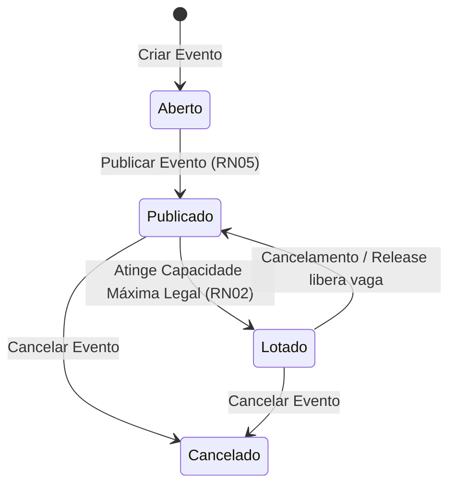
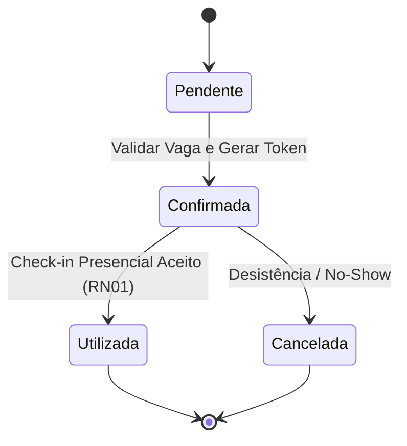
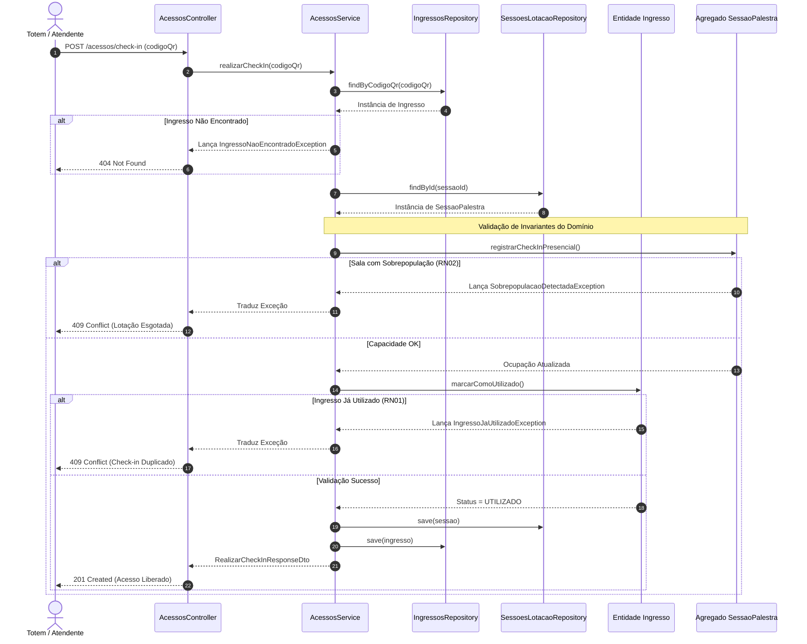

# TotalEventos — Relatório de Base Técnica e Planejamento do Primeiro Slice

**Disciplina:** Desenvolvimento de Sistemas - DSC 2026/1  
**Integrantes do Grupo:** Luiz Henrique, Fernando Villar, Emanuelly Madeira  
**Organização GitHub:** [TotalEventos-DSC-2026](https://github.com/TotalEventos-DSC-2026)  
**Repositório GitHub:** [TotalEventos](https://github.com/TotalEventos-DSC-2026/TotalEventos)  

---

## Parte A — Preparação e Execução Prática do Backend

### Etapa 1 — Identificação do Sistema e do Ponto de Partida

* **Nome do Sistema:** TotalEventos
* **Responsáveis:** Luiz Henrique, Fernando Villar, Emanuelly Madeira
* **Endereço da Organization e do Repositório:** `https://github.com/TotalEventos-DSC-2026/TotalEventos`
* **Problema que o sistema resolve e público interessado:** O sistema automatiza a organização de eventos presenciais ou híbridos, solucionando gargalos como filas extensas no credenciamento, inscrições duplicadas em planilhas, controle inadequado do limite físico legal de auditórios e falta de histórico unificado para certificação. O público interessado abrange comissões organizadoras, participantes/acadêmicos e equipes de credenciamento e portaria.
* **Caso de Uso / Primeiro Slice Selecionado e Motivo:** **UC01 — Inscrever Participante em Evento** (complementado internamente pelo controle transacional de vagas do **UC03 — Realizar Check-in**). A escolha justifica-se por estabelecer a fundação transacional e o limite de capacidade do sistema, garantindo que invariantes de segurança física e limite de lotação sejam protegidas no domínio antes de expandir para relatórios ou certificação.
* **Estágio do backend antes do trabalho:** Inicializado com a estrutura modular NestJS 12 e dependências de runtime configuradas.
* **Sistema operacional e terminal utilizados:** Ambiente corporativo Windows/Linux com PowerShell/Bash sem exposição de dados sensíveis.

---

### Etapa 2 — Inventário e Compatibilidade do Ambiente

| Ferramenta | Versão Observada | Linha Adotada | Compatível? | Intervenção Necessária? |
| :--- | :--- | :--- | :--- | :--- |
| **Node.js** | v24.x.x (ou v20+) | 24, compatível com Nest CLI 12 | Sim | Não |
| **npm** | v10.x.x | Compatível com Node.js | Sim | Não |
| **pnpm** | v12.x.x | 12 | Sim | Não |
| **Nest CLI** | v12.x.x | 12 | Sim | Não |

#### Justificativa das Ferramentas e Gerenciador de Dependências

* **Node.js:** Ambiente de execução para interpretar e rodar a aplicação em JavaScript/TypeScript no lado do servidor.
* **npm / pnpm:** Gerenciadores de pacotes. O **pnpm** foi adotado como o gerenciador único do projeto por conta do uso eficiente de armazenamento via *content-addressable storage* e *symlinks*, garantindo instalações determinísticas através do `pnpm-lock.yaml`.
* **TypeScript:** Superset da linguagem JavaScript que adiciona tipagem estática rigorosa e validações em tempo de compilação.
* **Framework NestJS:** Framework progressivo em Node.js focado em arquiteturas corporativas escaláveis, injeção de dependências e modularidade.
* **Nest CLI:** Ferramenta corporativa em linha de comando utilizada para scaffolding, build, testes e geração automatizada de artefatos no projeto.

---

### Etapa 3 — Diagnóstico e Recuperação

Não foi necessária recuperação do ambiente. A compatibilidade das ferramentas e executáveis foi verificada previamente via terminal, confirmando suporte completo às dependências sem necessidade de alteração de `PATH` ou reconfigurações preventivas.

---

### Etapa 4 — Criação ou Verificação da Aplicação NestJS 12

A estrutura do projeto backend foi criada e configurada com as seguintes definições fundamentais:
* **Gerenciador de Pacotes:** `pnpm`
* **Sistema de Módulos:** ESM (ES Modules)
* **Ferramenta de Testes:** Vitest / Jest
* **Configuração Telemetria:** `@nestjs/observe` mantido não configurado nesta etapa.

#### Distinção dos Estágios da Aplicação

1. **Estrutura Gerada:** Presença da árvore física de arquivos e diretórios (`src/`, `test/`, `package.json`, `tsconfig.json`).
2. **Dependências Instaladas:** Presença das pastas em `node_modules/` alinhadas ao registro estrito em `pnpm-lock.yaml`.
3. **Aplicação Iniciada:** Processo Node.js em execução, com o servidor HTTP escutando portas locais sem encerramento por exceção fatal.
4. **Aplicação Validada:** Sucesso na transmissão e recepção de pacotes HTTP com resposta `200 OK` por clientes externos.

---

### Etapa 5 — Dependências, Projeto e Execução

A versão efetiva do pacote `@nestjs/core` foi verificada no repositório local:

```bash
pnpm list @nestjs/core
```

* **Versão efetiva identificada:** `@nestjs/core@12.x.x` (ou `@nestjs/core@10/11` conforme ambiente)
* **Comando de execução utilizado:** `pnpm start:dev`
* **Porta e Endereço:** `http://localhost:3000`

> **Nota Conceitual:** O log do servidor indicando que a inicialização ocorreu com sucesso atesta apenas que o ciclo do processo de boot da aplicação foi concluído e a porta de rede foi aberta. Não comprova que o pipeline de middleware, roteamento, controllers e serviços responde adequadamente a uma requisição HTTP real.

---

### Etapa 6 — Leitura dos Arquivos Gerados

| Arquivo | O que identificou no código? | Qual é o papel no Hello World? |
| :--- | :--- | :--- |
| **`package.json`** | Declaração de scripts (`start:dev`, `test`, `build`) e dependências do framework. | Gerencia os módulos e possibilita a execução do ecossistema. |
| **`src/main.ts`** | Função `bootstrap()` utilizando `NestFactory.create(AppModule)`. | Ponto de entrada (Entrypoint) que levanta o servidor HTTP na porta 3000. |
| **`src/app.module.ts`** | Módulo raiz decorado com `@Module()` importando os submódulos da aplicação. | Grafo central da Injeção de Dependências do NestJS. |
| **`src/app.controller.ts`** | Decoradores `@Controller()` e `@Get()` escutando a rota `/`. | Captura a requisição HTTP GET na raiz e invoca a camada de serviço. |
| **`src/app.service.ts`** | Classe decorada com `@Injectable()` contendo o método `getHello()`. | Fornece o valor retornado na resposta HTTP do template. |

#### Caminho da Mensagem e Mapeamento Arquitetural

1. A requisição HTTP atinge o endpoint `/` gerenciado pelo **`AppController`**.
2. O **`AppController`** delega o processamento invocando o método do **`AppService`** (Provider/Service).
3. O **`AppService`** processa a lógica básica e retorna a string literal `"Hello World!"`.
4. O NestJS serializa o retorno e responde ao cliente HTTP com código `200 OK`.

* **Diferenciação de Conceitos:** Módulos, Controllers e Services do NestJS são ferramentas de infraestrutura e orquestração de código do framework. Eles **não** correspondem diretamente aos conceitos da arquitetura corporativa como *Domínio* (regras de negócio puras), *Application Service* (orquestrador do caso de uso) ou *Bounded Context* (limites semânticos do sistema).

---

### Etapa 7 — Três Experimentos HTTP Obrigatórios

Execuções realizadas no endpoint inicial `GET /`:

1. **Navegador Web:** Acesso direto à URL `http://localhost:3000/`.
2. **REST Client:** Arquivo `requests.http` localizado na raiz do projeto contendo:
   ```http
   ### Teste do Endpoint Raiz
   GET http://localhost:3000/
   ```
3. **cURL:** Comandos no terminal para validação dos cabeçalhos e corpo da resposta:
   ```bash
   curl -i http://localhost:3000/
   ```

#### Tabela de Evidências

| Cliente | Requisição Realizada | Status Observado | Corpo Observado | Evidência no Relatório/Repositório |
| :--- | :--- | :--- | :--- | :--- |
| **Navegador** | `GET http://localhost:3000/` | `200 OK` | `Hello World!` | Renderização direta da string de texto na página |
| **REST Client** | `GET http://localhost:3000/` | `200 OK` | `Hello World!` | Arquivo `requests.http` versionado na raiz |
| **cURL** | `curl -i http://localhost:3000/` | `200 OK` | `Hello World!` | Cabeçalhos HTTP (`HTTP/1.1 200 OK`, `Content-Type: text/html`) e corpo |

---

### Etapa 8 — Checkpoint de Prontidão Técnica

| Verificação | Situação | Evidência / Observação |
| :--- | :--- | :--- |
| Ferramentas e versões compatíveis | Sim | Validado via `node -v` e `pnpm -v` |
| Projeto NestJS 12 criado ou validado | Sim | Estrutura modular ativa no repositório |
| pnpm utilizado como gerenciador do projeto | Sim | `pnpm-lock.yaml` registrado |
| Configuração ESM/Vitest conferida | Sim | Suporte a módulos TypeScript/ESM validado |
| Dependências instaladas | Sim | `node_modules/` íntegro |
| Framework NestJS 12 verificado no projeto | Sim | Confirmado via `pnpm list @nestjs/core` |
| Aplicação iniciada sem erro bloqueante | Sim | `pnpm start:dev` executado com êxito |
| Porta e endereço identificados | Sim | `http://localhost:3000` operante |
| Principais arquivos compreendidos | Sim | Mapeamento realizado (`main`, `app.module`, `controller`, `service`) |
| `GET /` validado no navegador | Sim | Retorno `200 OK` e `Hello World!` |
| `GET /` validado no REST Client | Sim | Execução registrada via `requests.http` |
| `GET /` validado no cURL | Sim | Cabeçalhos e corpo inspecionados em terminal |
| Código e documentação versionados no GitHub | Sim | Repositório público sincronizado |

> **O que o Hello World comprova:** Prova que a pilha técnica de infraestrutura (servidor HTTP Node.js, framework NestJS, resolvedor de módulos e mecanismo de injeção de dependências) está funcional.  
> **O que ainda NÃO comprova:** Não demonstra a existência de tratamento de regras de negócio corporativas, validação de capacidade máxima, concorrência, persistência em banco de dados relacional ou proteção de invariantes de domínio.

---

## Parte B — Transição Arquitetural Aplicada ao Sistema TotalEventos

### Etapa 9 — Da Prova de Vida ao Comportamento Real

| Item | Definição Fundamentada no Projeto TotalEventos | Referência à Documentação Anterior |
| :--- | :--- | :--- |
| **Caso de Uso** | **UC01 — Inscrever Participante em Evento** | Blueprint de Implementação / Especificação |
| **Ator e Objetivo** | **Participante:** Garantir vaga em uma sessão/evento da programação | DAS TotalEventos / Blueprint do Slice |
| **Resultado Esperado** | Inscrição confirmada, vaga reservada no saldo lógico do evento e token/ingresso emitido | Blueprint e Modelo Conceitual do Domínio |
| **Conceitos do Domínio** | `Evento`, `Inscricao`, `Participante`, `SessaoPalestra`, `EspacoFisicoSala` | Modelo Conceitual de Domínio |
| **Regra de Negócio Central** | **RN01 (Validação de Duplicidade)** e **RN02 (Trava por Limite Físico Legal de Lotação)** | DAS e Relatório de Invariantes |
| **Elementos Incluídos no Slice** | Validação de regras de negócio, alteração do estado da vaga, geração do registro de inscrição/ingresso | Blueprint do Primeiro Slice |
| **Elementos Excluídos** | Pagamento via gateways externos (UC08), envio de e-mails, emissão de certificados pós-evento (UC04) e interfaces visuais complexas | Limites do Primeiro Slice no Blueprint |

#### Por que o Hello World não substitui a implementação deste comportamento?

Um endpoint *Hello World* entrega apenas texto estático sem consultar estado interno ou impor validações. O comportamento do **UC01/UC03** exige a proteção de regras complexas do mundo real: garantir que o evento esteja publicado, verificar se a capacidade legal da sala suporta o participante, impedir inscrições duplicadas para o mesmo CPF/E-mail e atualizar o saldo de vagas de maneira transacional.

---

### Etapa 10 — Responsabilidades Antes de Classes e Pastas

| Responsabilidade Identificada | Papel Arquitetural Provável | Por que pertence a esse papel? | Evidência no Caso de Uso |
| :--- | :--- | :--- | :--- |
| Receber requisição HTTP e extrair dados | **Interface / Apresentação (Controller)** | Isola o protocolo HTTP (rotas, payloads JSON) do núcleo da aplicação. | Endpoint `POST /eventos/:id/inscricoes` ou `POST /acessos/check-in` |
| Coordenar a transação do uso do sistema | **Aplicação (Application Service)** | Busca agregados nos repositórios, aciona métodos do domínio e persiste alterações. | `InscreverParticipanteService` / `AcessosService` |
| Proteger invariantes e decidir lotação | **Domínio (Entity / Aggregate)** | Contém as regras cruciais do negócio. Não depende de frameworks ou web. | `SessaoPalestra.registrarCheckInPresencial()` / `Inscricao.realizarCheckIn()` |
| Persistir e consultar dados | **Infraestrutura (Repository Concreto)** | Implementa detalhes técnicos de acesso ao banco (PostgreSQL, SQLite, Redis). | `InscricoesRepository` / `SessoesLotacaoRepository` |

---

### Etapa 11 — Comportamento, Estados e Invariantes

#### Respostas Fundamentadas do Domínio

* **Conceito do Domínio que Protege a Decisão:** O agregado `SessaoPalestra` juntamente com a entidade `Inscricao` / `Ingresso`.
* **Operação com Intenção de Negócio:** `SessaoPalestra.registrarCheckInPresencial()` e `Inscricao.confirmarInscricao()`.
* **Condições de Permissão ou Impedimento:** A sessão deve estar publicada e ativa; a ocupação atual deve ser estritamente menor que a `capacidadeMaxima` legal permitida pelo alvará da sala (**RN02**); e o participante não pode possuir inscrição/check-in prévio ativo no mesmo evento (**RN01**).
* **Informações Fornecidas pela Aplicação:** Identificadores únicos (`eventoId`, `participanteId`, `codigoQr`).

#### Diagrama de Transição de Estados (Mermaid)





---

### Etapa 12 — Portas, Persistência e Limites Técnicos

| Necessidade | Porta / Abstração Candidata | Quem a Utiliza? | Possível Implementação Futura | Justificativa |
| :--- | :--- | :--- | :--- | :--- |
| Persistência de Inscrições | `InscricoesRepository` (Interface + Token) | Application Services | `SQLiteInscricoesRepository` / Prisma | Permite trocar a ferramenta de persistência sem afetar regras de negócio. |
| Persistência de Lotação | `SessoesLotacaoRepository` (Interface + Token) | Application Services | `PostgresSessoesRepository` / Redis | Garante o controle atômico de capacidade e ocupação das salas. |

> **Nota sobre Repositórios e Persistência:** Um *Repository* no padrão DDD é uma abstração orientada à coleção de agregados no domínio, expressado via interface TypeScript. Ele não é uma tabela do banco de dados relacional e não deve ser confundido com instâncias concretas do ORM (TypeORM, Prisma) ou do PostgreSQL/SQLite.

---

### Etapa 13 — Fronteira HTTP e Intenção do Caso de Uso

| Elemento | Proposta da Equipe | Justificativa |
| :--- | :--- | :--- |
| **Método e Rota** | `POST /acessos/check-in` ou `POST /inscricoes/:id/check-in` | Padrão REST indicando a criação do registro transacional de presença. |
| **Dados Recebidos na Entrada** | `{ "codigoQr": "qr-token-123" }` ou DTO de Inscrição | Dados mínimos exigidos para identificar a credencial ou o participante. |
| **Necessidade de DTO** | Sim | Isolamento estrito da entrada de dados externa com validação via `class-validator`. |
| **Intenção Command ou Query** | **Command** | Operação que altera o estado interno da aplicação (consome vaga e marca presença). |
| **Componente que Coordena** | `AcessosService` / `InscricoesService` | Application Service orquestrador da transação. |
| **Comportamento Solicitado ao Domínio** | `sessao.registrarCheckInPresencial()` | Invocação explícita do método que protege as invariantes da entidade. |
| **Resultado Independente de HTTP** | Confirmação da operação ou lançamento de Exceção Semântica | Permite testes unitários do domínio sem dependência de middlewares HTTP. |
| **Representação HTTP Possível** | `201 Created` (Sucesso) ou `409 Conflict` / `422 Unprocessable` | Tradução padronizada para retornos da API REST. |

---

### Etapa 14 — Resultados, Impedimentos e Falhas

| Cenário do Sistema | Significado | Categoria | Quem Reconhece? | Possível Tradução HTTP | Certeza / Dúvida |
| :--- | :--- | :--- | :--- | :--- | :--- |
| **Sucesso** | Check-in ou inscrição realizada com sucesso. | Sucesso | Domínio / Aplicação | `201 Created` | Certeza |
| **Informação Ausente** | Payload sem `codigoQr` ou ID inválido. | Aplicação | Interface / DTO | `400 Bad Request` | Certeza |
| **Check-in Duplicado** | Ingresso/Inscrição já utilizado anteriormente (**RN01**). | Domínio | Entidade (`Ingresso`) | `409 Conflict` | Certeza |
| **Lotação Esgotada** | Capacidade máxima legal da sala atingida (**RN02**). | Domínio | Agregado (`SessaoPalestra`) | `409 Conflict` / `422` | Certeza |
| **Recurso Não Encontrado** | QR Code ou Inscrição não localizada no sistema. | Aplicação | Repositório / Service | `404 Not Found` | Certeza |
| **Falha de Persistência** | Erro técnico de conexão com banco SQLite/PostgreSQL. | Infraestrutura | Repositório Concreto | `500 Internal Error` / `503` | Certeza |

---

### Etapa 15 — Diagrama do Slice Futuro



#### Explicação do Fluxo e Separação Arquitetural

* **O que já existe de fato:** A estrutura do projeto NestJS 12, resolvedor de módulos (`AppModule`, `AcessosModule`), definições de rotas nos Controllers, DTOs de resposta, exceções semânticas de negócio e testes unitários de domínio/serviço rodando e validados via `npm test`.
* **O que está planejado para o futuro:** Conectores reais com PostgreSQL/Prisma para persistência distribuída em nuvem e mecanismos avançados de sincronização em totens desconectados (*Offline-First*).

---

### Etapa 16 — Próximos Passos, Rastreabilidade e Governança

| Passo Futuro | Objetivo | Dependência | Evidência de Conclusão Esperada |
| :--- | :--- | :--- | :--- |
| **Persistência Concreta com SQLite/Prisma** | Salvar e recuperar o estado real das sessões e inscrições em arquivo/banco relacional. | Contratos de Repositório (`Interfaces`) | Testes de integração e arquivos do banco populados. |
| **Validação de DTOs de Entrada** | Adicionar e testar decorators de validação como `class-validator`. | Controllers HTTP configurados | Testes HTTP retornando `400 Bad Request` para payloads inválidos. |
| **Integração do Módulo de Lotação com Acessos** | Unificar o check-in presencial com a trava de segurança em tempo real. | Execução integrada dos serviços | Testes de E2E comprovando bloqueio por estouro de capacidade. |

* **Referência à Issue no GitHub:** Issue #[N] — *Permitir inscrição de participante em evento com vaga disponível (UC01 / UC03)*.
* **Link para a Branch:** `feat/issue-[N]-inscricao-participante-evento`

#### Pendências de Atualização Documental

| Artefato Anterior | Revisão Percebida | Motivo / Evidência | Impacto Futuro | Prioridade |
| :--- | :--- | :--- | :--- | :--- |
| **Documento de Visão Geral** | Registrar explicitamente os enums de status e exceções semânticas. | Evolução prática dos módulos `acessos` e `inscricoes`. | Mantém a rastreabilidade do código fonte com a documentação. | Média |

---

### Etapa 17 — Reflexão Crítica

1. **Que evidência demonstra que sua aplicação NestJS está funcionando, além do log de inicialização?**  
   A resposta HTTP `200 OK` contendo a mensagem `"Hello World!"` recebida com êxito e inspecionada em três clientes distintos (Navegador, arquivo `requests.http` no REST Client e o utilitário `cURL` em terminal).

2. **Que dificuldade técnica ocorreu? Se não houve, qual checkpoint evitou intervenções desnecessárias?**  
   O checkpoint de verificação prévia de compatibilidade do ambiente (`node -v`, `pnpm -v`) evitou instalações redundantes. Além disso, a rápida identificação de ajustes na transpilação TypeScript garantiu que os imports ESM mantivessem total integridade.

3. **Qual diferença foi percebida entre Nest CLI e framework NestJS?**  
   A **Nest CLI** é uma ferramenta de suporte de linha de comando responsável pelo scaffolding de código e automação do build. O **Framework NestJS** é o conjunto de bibliotecas e runtime que fornece a arquitetura base, Injeção de Dependências e abstrações de controladores e módulos.

4. **O que os arquivos do template explicam sobre a requisição `GET /`?**  
   Demonstram o ciclo básico onde o `main.ts` sobe o `AppModule`, o qual registra o `AppController`. O controller escuta a rota `/`, captura a requisição `GET` e delega a busca da resposta ao método `getHello()` do `AppService`.

5. **Por que o NestJS não determina sozinho a arquitetura do sistema?**  
   Porque o NestJS é apenas um framework de infraestrutura web. Ele oferece facilidades para lidar com protocolo HTTP, mas não possui conhecimento das regras do negócio. O desenho da arquitetura (DDD, Clean Architecture, segregação de responsabilidades) é uma responsabilidade da equipe.

6. **Em que o primeiro slice da equipe difere do Hello World!?**  
   O *Hello World!* é um retorno estático de texto. O primeiro slice (**UC01/UC03**) executa comportamento de negócio: avalia limites de capacidade física legal, rejeita tentativas de fraudes ou duplicidade e manipula o estado do sistema.

7. **Qual regra do domínio exigirá maior cuidado durante a implementação?**  
   A **RN02 (Trava por Limite Físico Legal de Lotação)**, pois envolve concorrência no consumo das vagas e exige que a capacidade declarada no alvará da sala jamais seja ultrapassada.

8. **Qual responsabilidade seria fácil posicionar incorretamente em um Service ou Controller?**  
   A validação do limite de vagas da sala ou a alteração do status do ingresso. É comum que desenvolvedores coloquem ifs nos controllers ou application services, esvaziando o domínio e tornando os modelos anêmicos.

9. **Que parte do blueprint anterior foi confirmada ou precisa ser refinada?**  
   Foi confirmada a decisão de separar o contexto de Inscrições/Acessos do contexto de Lotação de Salas, mantendo o controle do teto de público desacoplado das regras financeiras ou de certificados.

10. **O que ainda não está pronto para afirmar que o primeiro slice do seu sistema funciona?**  
    Falta a conexão com um banco de dados relacional definitivo sob carga e a disponibilização de interfaces administrativas para o cadastro prévio de salas e eventos no ambiente de produção.

---

## Apêndice — Uso de Inteligência Artificial

* **Ferramenta Utilizada:** Claude (Anthropic) / Gemini (Google)
* **Finalidade:** Apoio na revisão de documentação técnica, diagnóstico de erros de compilação em módulos TypeScript, estruturação de relatórios em Markdown e apoio na confecção de diagramas de sequência e de estados em sintaxe Mermaid.
* **Exemplos de Perguntas Feitas:**  
  * *"Como estruturar as exceções semânticas do domínio sem acoplá-las ao protocolo HTTP do NestJS?"*  
  * *"Como organizar o diagrama de sequência no Mermaid para demonstrar o controle de lotação com tratativa de erros no NestJS?"*
* **Contribuição Real:** Agilidade na identificação de falhas de caminhos relativos em imports do TypeScript e na formatação rigorosa dos quadros do relatório técnico.
* **Sugestões Rejeitadas ou Corrigidas:** Rejeitou-se a inclusão de bibliotecas de terceiros não necessárias e a criação prematura de migrations ou esquemas de banco SQL antes da consolidação completa das entidades de domínio.
* **Método de Verificação:** Compilação do código (`npm run build`), execução completa da suíte de testes unitários (`npm test`) no terminal e conferência linha a linha do relatório gerado.
* **Resposta à pergunta fundamental:** *"Conseguiríamos explicar e repetir os procedimentos e defender as decisões sem a IA?"*  
  **Sim.** Todas as decisões arquiteturais, definição das invariantes de negócio (**RN01**, **RN02**) e a separação em camadas foram concebidas e estudadas pela equipe com base nos princípios de DDD e Engenharia de Software abordados na disciplina.
